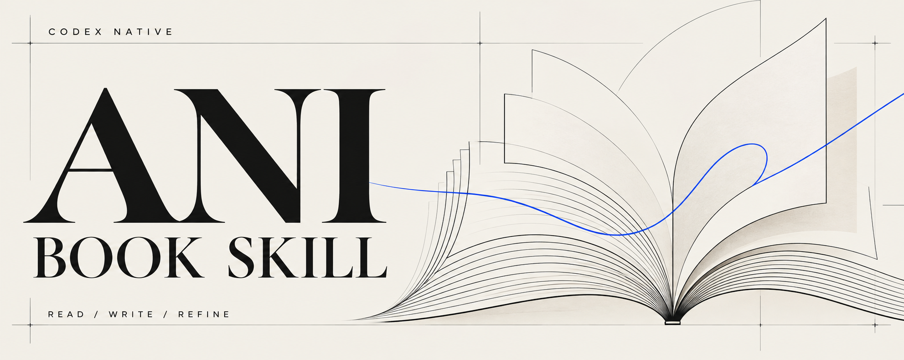
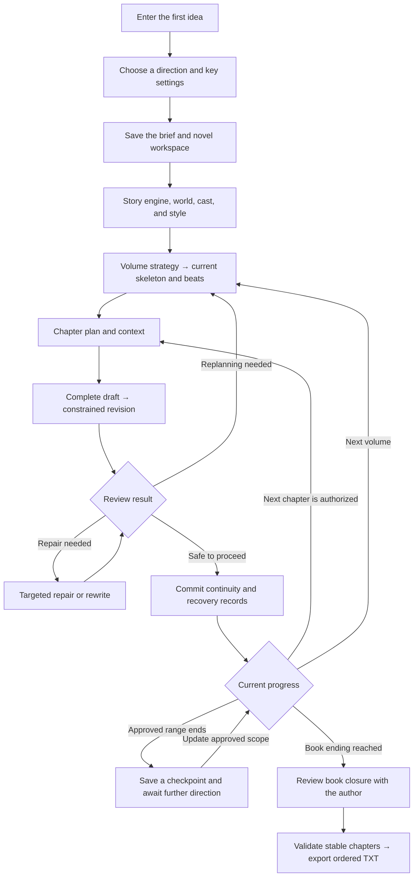
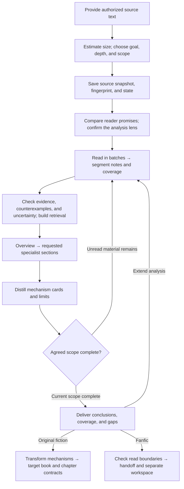

<div align="center">

# Ani Book Skill

**Keep long-form fiction moving, from the first idea to accepted prose.**

Book planning · Reference analysis · Original adaptation · Fanfic · Style and humanization · Serial fiction

[](https://github.com/ExplosiveCoderflome/ani-book-skill/actions/workflows/validate.yml)
[](requirements.txt)
[](LICENSE)

[Quick start](#quick-start) · [Novel pathway](#from-first-idea-to-a-finished-novel) · [Analysis pathway](#from-reference-analysis-to-writing) · [Style and humanization](#style-and-humanization) · [Local reader](#local-reader) · [Changelog](docs/releases/release-notes.md) · [中文](README.md)

</div>



Ani Book Skill is a **Codex-native Skill for long-form Chinese fiction**. It organizes research, planning, prose, revision, and continuity into a resumable workflow, with artifacts stored in local Markdown / YAML files that you can read, edit, and back up.

**Codex understands and creates; the Skill defines the process; local tools check state, versions, and dependencies.** You can decide key settings yourself or delegate a defined scope to Codex.

## Capabilities

| Your goal | What you get |
| --- | --- |
| **Start a novel** | Five opening seeds, two distinct brief previews, reader positioning, a story engine, and early volume plans. A selected direction can proceed directly. |
| **Find genre opportunities** | Public chart metadata snapshots, chart composition, and opportunity cards. Comparable dates support claims about change. |
| **Analyze a reference work** | Reading scope and coverage, segment notes, core reader promises, characters and relationships, structure, craft mechanisms, and traceable evidence. |
| **Use research in an original novel** | Mechanisms selected for the target story, an original transformation, bounded chapter references, and review of their actual effect. |
| **Write fanfic** | Continue from a fully documented chapter ending, or start a new story using authorized canon within the read scope. |
| **Maintain style and reduce template-like prose** | A book-level writing contract and character voice guidance, applied from the first draft through targeted revision and review. |
| **Serialize and revise** | Volume strategies, beat sheets, chapter plans, coherent prose, review, continuity commits, recovery, and stable exports. |
| **Develop a series or shared universe** | Cross-book assets, independent forks, shared update notices, canon timelines, and impact checks. |

## From first idea to a finished novel

**One idea is enough to begin.** Establish the reader experience, develop the book direction, and plan the current volume and chapter. Produce chapters within the approved scope, then review the ending and export the completed text.



| Stage | Your part | What the Skill produces or advances |
| --- | --- | --- |
| **1. Supply a starting point** | Describe a character, conflict, scene, or reading experience. | Five seeds if you have no idea; two briefs when exploring; direct reuse of a selected direction or explicit delegation. |
| **2. Set the direction** | Confirm or delegate the reader, genre, core reward, publication format, and content boundaries needed now. | `novel-brief.md`; durable production saves a `novels/<title>/` workspace with progress and the next action in `novel-state.yaml`. |
| **3. Build the foundation** | Establish the main thread, character choices, ending direction, and style preferences. | The story engine, `story-bible.md`, world and character documents, and an optional `writing-style.md`. |
| **4. Plan the current volume** | Confirm stage goals, major conflicts, and the production range. | Book-level volume strategy develops into the current skeleton, beat sheet, and chapter responsibilities. Near-term plans are concrete; distant plans remain flexible. |
| **5. Produce chapters** | Read, correct, or accept at agreed checkpoints; you can delegate a range. | Chapter plan → context → complete prose → revision → review. Repairs are reviewed again; structural problems return to planning. |
| **6. Sustain progress** | Give feedback and decide the next scope when the approved range ends. | Chapters cleared to proceed commit facts, promises, and character and relationship changes before the next chapter. Volume endings trigger payoff checks and rolling plans. |
| **7. Close the book** | Confirm the ending and any intentionally open questions. | Codex compares the brief, story bible, volume plans, and continuity to check main-thread payoffs, character arcs, promises, and unresolved issues, then revises gaps. |
| **8. Accept and export** | Confirm the final prose and delivery scope. | Check chapter coverage, matching review versions, and continuity commits; resolve blockers, then export stable prose to TXT. |

**Completion means fulfilling the story's promises.** The main conflict and ending need a result, as do character and relationship changes. Outstanding promises should be paid off or deliberately left open by the author. Codex reviews closure using the existing artifacts, the author confirms it, and the exporter checks and combines stable chapters.

Start with:

> Use `$produce-long-form-novel`. My first idea is: … Guide me from opening to completion. Save a novel workspace, confirm key settings progressively, and work within the chapter ranges I approve. At the ending, review book closure and export TXT.

Resume with:

> Continue `novels/my-book/`. Read state and recovery records first, summarize progress, unresolved issues, and the next action, then proceed within existing authorization.

[Opening and settings](references/novel-brief.md) · [Book and volume planning](references/story-and-volume-planning.md) · [Workspaces and artifacts](references/artifact-contracts.md) · [Chapter production](references/chapter-production.md)

## From reference analysis to writing

### From source text to analysis delivery

**Decide what to read and why, then build evidence segment by segment.** Analyze a selected window or work through the full text in batches. Every conclusion retains its actual reading scope, supporting later analysis and creative use.



| Stage | Work | Saved results |
| --- | --- | --- |
| **1. Source and scope** | Provide authorized text, estimate length and tokens, and choose full or partial coverage plus structural, character, craft, or other goals. | `source-manifest.md`, the `source/` snapshot, and source fingerprints. |
| **2. Confirm the lens** | Compare evidence-backed core candidates, separate reader rewards from surface events, and confirm priorities and optional character tracking. | `analysis-state.yaml` and a confirmed `analysis-lens.md`. |
| **3. Read in batches** | Record events, choices, relationship changes, and promises within each window. | `notes/segment-NNN.md`, `coverage-map.md`, and optional `characters/` cards. |
| **4. Evidence and analysis** | Distinguish facts, inferences, and hypotheses; retain source anchors, counterexamples, and gaps. Build retrieval from notes, then create the overview and requested sections. | `evidence-ledger.md`, `uncertainty-ledger.md`, `sections/overview.md`, and specialist sections. |
| **5. Extract reusable mechanisms** | Explain why each works, its conditions, how to transform it, and what remains uncertain. | `pattern-cards.md`; original chapter integration also prepares validated `pattern-cards.yaml` and evidence references. |
| **6. Deliver, extend, or write** | Inspect coverage and remaining scope. Continue reading or choose original transfer, new fanfic, or continuation. | A resumable analysis workspace and a transformation plan or fanfic handoff for the chosen destination. |

**Completing a partial scope is labeled as partial analysis.** Full-text coverage requires actually reading the agreed full text. Further batches read existing state, the lens, and notes before taking the next `remaining_scope`. Expanded coverage or changed core conclusions trigger checks of affected summaries, cards, and creative references.

Start with:

> Use `$produce-long-form-novel` to analyze this text I am authorized to use: `<file path>`. Estimate its size and agree on scope and priorities with me, then compare and confirm the core reader promise. Keep batch notes and evidence; deliver an overview, requested sections, reusable mechanisms, and coverage gaps.

Then continue with:

> Continue the remaining scope in `analyses/my-reference/`; or use its confirmed mechanisms to design original novel directions, explaining which reader rewards carry forward and how the cast and events will be rebuilt.

### Identify what sustains the reader's interest

Analysis starts with an authorized source, a reading scope, and a purpose. It compares candidate reader promises, keeping **the experience readers repeatedly seek** separate from **the events that deliver it**. Evidence, counterexamples, and counterfactual checks help identify which elements are essential.

Reusable results include:

- **Story engines:** why characters act, and how rewards and costs create a repeatable cycle.
- **Character and relationship mechanisms:** desire, choice, information gaps, changing relationships, and consequences.
- **Structure and pacing:** escalating conflict, information release, staged payoffs, and chapter endings.
- **Craft methods:** viewpoint, scene organization, distinct dialogue, and detail selection.
- **Evidence and limits:** where a conclusion comes from, how much was read, its prerequisites, and its failure conditions.

Dimensions follow the genre and source evidence. Analysis does not require every book to use the same power ladder or relationship model. Notes and cards are searchable; conclusions retain their sources and coverage, with facts, inferences, and hypotheses kept distinct.

### Three creative uses for the same research

| Mode | What carries forward | How it proceeds |
| --- | --- | --- |
| **Original mechanism transfer** | Abstract principles, reader rewards, and operating conditions | Rebuild the cast, world, and events; put the transformed mechanism into the target chapter contract. |
| **New fanfic story** | Established characters and setting within the read scope | Define the starting point and new-story boundaries in a separate novel workspace. |
| **Fanfic continuation** | A fully documented ending and its unresolved promises | Complete a handoff, then continue with a step that has not already happened. |

Handoffs and references pin the analysis they use. **A changed core conclusion invalidates the old handoff even when the original text is unchanged.** Sources are checked again before production continues.

[Analysis workflow](references/book-analysis.md) · [Retrieval and evidence](references/book-analysis-retrieval.md) · [Research into original fiction](references/analysis-to-novel.md) · [Fanfic workflow](references/fanfic.md)

## Style and humanization

The project's approach to a writing-style engine is an editable **book-level style contract**: narrative distance, character voice, dialogue, rhythm, detail, and clear permissions for observations versus targeted edits.

Style can come from the author's own samples, accepted chapters, explicit preferences, or transferable methods in authorized analysis. Each book keeps a `writing-style.md` snapshot; reusable cards live in private `styles/`. Style configuration is optional at the beginning and can develop after the first chapters.

`Effective style → first-draft application → one constrained revision → review against the same contract → targeted repair`

Humanization focuses on clusters of templated language, vague explanation, converging character voices, and scenes that fail to progress. Edits need concrete evidence and preserve effective passages. Observation-only rules remain the author's decision. Corrections are saved with their scope—wording, expression, or story settings—for later chapters to read.

### Add methods from GitHub

You can explicitly ask Codex to obtain writing-style or humanization Skills:

`Register source → fetch candidate → pin version and verify content → review rules → author confirmation → local book snapshot`

Candidates stay in a private directory with checks for file boundaries, content digests, and size. Updates retain the current version until reviewed; chapter production uses local snapshots. Prose evidence determines whether a rule helps. Detector scores are not the sole acceptance criterion.

[Style contract](references/style-engine.md) · [Chinese-fiction revision](references/chinese-novel-humanization.md) · [GitHub Skill sources](references/remote-skill-sources.md)

## Sustaining a long novel

Along the [first-idea-to-completion pathway](#from-first-idea-to-a-finished-novel), these checks apply to each chapter cycle:

| Stage | Current support |
| --- | --- |
| **Opening decisions** | Confirm high-impact choices progressively and reuse accepted directions and delegation. |
| **Chapter context** | Combine the plan, previous prose ending, brief, style, and relevant continuity; report missing required sources. |
| **Review and acceptance** | Bind acceptance to prose and contract versions; protect accepted prose and save old content before approved replacement. |
| **Changes and repair** | Invalidate outdated reviews after upstream regeneration; review repairs again and stop for structural replanning. |
| **Continuity and recovery** | Track facts, promises, resources, character state, and relationships; use state, recovery records, and checkpoints to resume. |
| **Volumes and export** | Assign chapters to volumes explicitly; export committed prose with matching accepted versions in numeric chapter order. |

The current chapter commits continuity before the next begins. Older workspaces support previews, backups, and explicit migration. YAML and accepted Markdown retain their respective authority; SQLite indexes and reader views are rebuildable.

Series projects can also extract private assets from accepted work. `fork` keeps an independent book version; `sync` tracks shared updates or conflicts. Author approval or active delegation governs shared canon publication, with timeline and impact checks supporting decisions.

[Chapter production](references/chapter-production.md) · [Review and repair](references/quality-and-repair.md) · [Recovery](references/auto-director-and-recovery.md) · [Cross-book assets and canon](references/cross-book-asset-graph.md)

## Quick start

### 1. Install in Codex

You need **Codex, Git, and Python 3.10+**. In PowerShell, run these commands where you want to keep the repository:

```powershell
git clone https://github.com/ExplosiveCoderflome/ani-book-skill.git
cd ani-book-skill
python -m pip install -r requirements.txt

$skillBase = if ($env:CODEX_HOME) { $env:CODEX_HOME } else { Join-Path $env:USERPROFILE '.codex' }
$skillTarget = Join-Path $skillBase 'skills/produce-long-form-novel'
python scripts/sync_skill_mirror.py sync . $skillTarget
python scripts/sync_skill_mirror.py check . $skillTarget
```

`in_sync: true` confirms that source and installation match. Invoke `$produce-long-form-novel` in a new Codex conversation after installation. After updating the source and passing project validation, use the same sync commands to refresh the installed copy.

### 2. Describe the work you want

| Starting point | Example for Codex |
| --- | --- |
| No idea | “Use `$produce-long-form-novel`. I have no idea yet; give me five opening seeds.” |
| Selected direction | “Use `$produce-long-form-novel` to create a novel from this selected direction. Recommend the remaining settings: …” |
| Reference analysis | “Analyze this text I am authorized to use. Estimate its size, confirm the scope, and compare its core reader promises.” |
| Original adaptation | “Design original directions from this analysis. Rebuild the cast and world, and explain which mechanisms carry over and how they change.” |
| Fanfic | “Continue from the last fully documented ending in this authorized analysis. Check the handoff conditions first.” |
| Style and humanization | “Distill a style contract from my samples. Check character voices and templated expression, showing evidence and suggested treatment.” |
| External methods | “Find GitHub humanization Skills suitable for Chinese fiction. Verify and review candidates, then propose useful rules.” |
| Serialization | “Continue `novels/my-book/`. Check state first, then finish prose, review, and continuity serially within the approved range.” |
| Export | “Check `novels/my-book/` and export stable chapters with matching accepted versions to TXT in order.” |

An explicit no-idea request starts with five seeds; direction exploration compares two briefs. **A concrete selected direction, a complete brief, or direct-production delegation reuses existing decisions and proceeds.** Artifacts are saved after durable workspace production is requested or confirmed; early exploration can remain in the conversation.

<details>
<summary><strong>Existing workspaces: common inspection and export commands</strong></summary>

Run these from the repository root, replacing the path with your workspace:

```powershell
$book = 'novels/my-book'
python scripts/novelctl.py status $book --format markdown
python scripts/novelctl.py next $book
python scripts/novelctl.py validate $book
python scripts/novelctl.py export $book --dry-run
python scripts/novelctl.py export $book
```

Preview an older workspace migration with `python scripts/novelctl.py migrate $book --dry-run`. Tools inspect, maintain, and export; Codex carries out creative steps. See [SKILL.md](SKILL.md) and the [artifact contracts](references/artifact-contracts.md).

</details>

## Local reader

The optional **ANI Local Reader** presents novel and analysis files in a browser:

- Bookshelf, document categories, and the full file tree.
- Chinese full-text search, headings, font sizes, and light/dark themes.
- Chapter navigation, source files, and fingerprints.
- Analysis coverage, gaps, mechanism cards, and evidence status.
- Copyable mechanism-integration requests for a target novel and chapter.

With **Node.js 22.18+ and npm**, run this from the repository root:

```powershell
./apps/workspace-reader/start-local.ps1
```

Open the [local reader](http://127.0.0.1:8790). Pass `-Roots 'C:/writing', 'D:/research'` for workspaces elsewhere. The reader accesses only explicitly configured local roots. Creation, editing, and state maintenance stay with Codex and the original workspace.

[Startup options, features, and limits](apps/workspace-reader/README.md)

## Files, privacy, and project scope

```text
SKILL.md                 Codex workflow entry point
references/              Planning, analysis, style, chapters, recovery, and asset contracts
scripts/                 State, validation, retrieval, candidate checks, and export
apps/workspace-reader/   Optional local read-only reader
docs/                    Release history and bounded quality self-checks
novels/                  Private novel workspaces
analyses/                Private reference analysis, sources, and evidence
styles/                  Private reusable style cards
trends/                  Private chart snapshots and research
libraries/               Private cross-book assets and shared canon
```

Manuscripts, source texts, research, and private asset directories are Git-ignored by default, with additional rules for environment files, keys, and backups. Authors can edit files directly; the workflow protects user edits and checks downstream invalidation. Token reporting distinguishes exact, estimated, and runtime-unavailable usage without presenting character counts as measured tokens.

Codex is the sole engine for creative understanding, planning, generation, review, and judgment. Python provides deterministic tools, and the local reader is optional. The project draws on long-form production experience from [AI-Novel-Writing-Assistant](https://github.com/ExplosiveCoderflome/AI-Novel-Writing-Assistant), organizing work through editable files and Skill contracts without requiring that project's frontend or backend services.

Chart research uses public metadata. Reference analysis uses authorized text and retains sources, scope, and evidence. Original work transfers abstract mechanisms; fanfic stays within the read scope. Humanization preserves facts, character goals, and author choices, with outcomes judged through prose and feedback.

[Full Skill rules](SKILL.md) · [Contributing](CONTRIBUTING.md) · [Security](SECURITY.md) · [Apache License 2.0](LICENSE)

## Latest update

### 2026-10-15

- **Added:** Local content, size, and version checks for GitHub writing-style and humanization Skill candidates.
- **Improved:** Core reader promises carry into writing, author corrections persist, selected directions proceed directly, and genre dimensions stay optional. A redesigned banner and Chinese and English pathways cover novel completion, reference analysis, and installation.
- **Fixed:** Accepted-prose protection, review version binding, required inputs, volume selection, continuity recovery, and stable exports.

See the [changelog](docs/releases/release-notes.md) for the full history.
