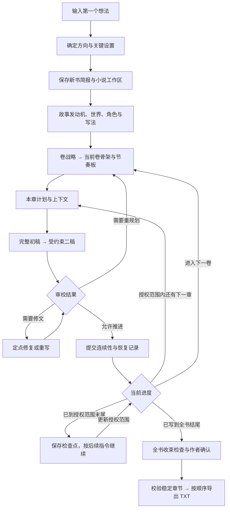
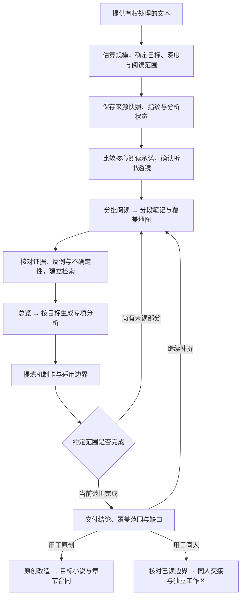

<div align="center">

# Ani Book Skill

**从灵感到定稿，让长篇创作持续推进。**

开书 · 拆书 · 原创机制迁移 · 同人创作 · 写法与去 AI 化 · 长篇连载

[](https://github.com/ExplosiveCoderflome/ani-book-skill/actions/workflows/validate.yml)
[](requirements.txt)
[](LICENSE)

[快速开始](#快速开始) · [完本路线](#从第一个想法到小说完本) · [拆书路线](#拆书如何进入创作) · [写法与去-ai-化](#写法与去-ai-化) · [本地阅读台](#本地阅读台) · [更新记录](docs/releases/release-notes.md) · [English](README.en.md)

</div>


Ani Book Skill 是面向中文长篇小说的 **Codex 原生 Skill**。它把选题、拆书、规划、正文、修订和连续性维护组织成可恢复的工作流，产物保存在你能直接阅读、编辑和备份的本地 Markdown / YAML 文件中。

**Codex 负责理解与创作，Skill 规定流程，本地工具核对状态、版本和依赖。** 你可以逐项决定关键设置，也可以把指定范围交给 Codex 推进。

## 功能一览

| 你的需求 | 可以得到什么 |
| --- | --- |
| **从零开书** | 五条开书种子、双方向简报、目标读者、故事发动机与首卷规划；已有明确方向时可直接推进。 |
| **寻找题材机会** | 基于公开榜单元数据的快照、题材构成与机会卡；有可比日期时再判断变化趋势。 |
| **拆解参考作品** | 阅读范围与覆盖地图、分段笔记、核心阅读承诺、人物与关系、结构和写法机制，以及可核对的证据。 |
| **把拆书用于原创** | 按目标小说需要选择机制，设计原创改造，接入当前章计划与上下文，并在审校时检查实际效果。 |
| **创作同人** | 在已授权、已读范围内，从完整章末续写，或沿用人物与设定另起新故事。 |
| **稳定写法、减少 AI 味** | 本书写法合同、人物声音与表达约束；从初稿起应用，二稿和审校按具体片段处理。 |
| **持续连载与修稿** | 卷战略、节奏板、章节计划、完整正文、修订、审校、连续性提交、中断恢复与稳定章节导出。 |
| **经营系列与共享 IP** | 跨书资产复用、独立分叉、更新提示、正史时间线与影响检查。 |

## 从第一个想法到小说完本

**起步只需要一句想法。** 先确定读者想看什么，再逐步形成全书方向、当前卷和当前章；按已批准的范围逐章推进，最后检查全书收束并导出。



| 阶段 | 你要做什么 | Skill 推进什么、留下什么 |
| --- | --- | --- |
| **1. 给出起点** | 描述一个人物、矛盾、场景或想看的体验。 | 没有想法时给五条种子；需要探索时比较两份简报；已有选定方向或明确委托时直接复用。 |
| **2. 确定开书方向** | 确认或委托决定当前必需的读者、题材、核心回报、发布形态和内容边界。 | 形成 `novel-brief.md`；进入正式生产后保存到 `novels/<书名>/`，由 `novel-state.yaml` 记录进度与下一步。 |
| **3. 建立全书支撑** | 确认主线、人物选择与结局方向，提供想保留的写法偏好。 | 建立故事发动机、`story-bible.md`、世界与角色资料；需要时形成 `writing-style.md`。 |
| **4. 规划当前卷** | 确认阶段目标、主要冲突和当前生产范围。 | 全书卷战略逐层落到当前卷骨架、节奏板和章节职责；近期具体，远期保留调整空间。 |
| **5. 逐章生产** | 在约定节点阅读、纠正或验收，也可授权连续推进一个范围。 | 本章计划 → 上下文 → 整章正文 → 二稿 → 审校；修复后重新审校，结构问题回到规划。 |
| **6. 持续推进** | 给出反馈；到达授权范围末尾后决定接下来的范围。 | 允许推进的章节先提交事实、伏笔、角色和关系变化，再进入下一章；卷末回看阶段兑现，滚动规划下一卷。 |
| **7. 收束全书** | 确认结局效果和有意保留的开放问题。 | Codex 对照简报、故事圣经、卷规划与连续性检查主线兑现、人物弧线、伏笔回收及未解决问题，再修订需补足的部分。 |
| **8. 验收与导出** | 确认最终正文和交付范围。 | 核对预定章节是否齐全、审校版本是否匹配、连续性是否提交，处理阻断问题后导出稳定正文 TXT。 |

**完本检查关注故事是否完成承诺。** 主冲突与结局需要落地，人物和关系的变化需要有结果；伏笔与未完事项应已兑现，或被作者明确保留。全书收束由 Codex 结合现有工件检查、作者确认，导出工具负责核对稳定章节并合并正文。

可以这样开始：

> 使用 `$produce-long-form-novel`。我的第一个想法是：……。请引导我从开书走到完本，保存小说工作区，逐步确认关键设置，按我批准的章节范围推进；写到结尾后检查全书收束并导出 TXT。

中断后可以说：

> 继续 `novels/my-book/`，先读取状态和恢复记录，告诉我当前进度、待解决问题及下一步，再在已有授权内继续。

[开书与设置](references/novel-brief.md) · [全书与卷规划](references/story-and-volume-planning.md) · [工件与工作区](references/artifact-contracts.md) · [章节生产](references/chapter-production.md)

## 拆书如何进入创作

### 从提供文本到拆书交付

**先确定读什么、为什么拆，再逐段建立证据。** 可以只拆选定窗口，也可以按批次完成全文；每份结论都保留实际阅读范围，后续还能继续补拆或接入创作。



| 阶段 | 主要工作 | 留下的资料 |
| --- | --- | --- |
| **1. 来源与范围** | 提供授权文本，估算长度与 Token 区间，确定全文或部分范围，以及结构、人物、写法等拆解目标。 | `source-manifest.md`、`source/` 原文快照与来源指纹。 |
| **2. 确认拆书透镜** | 比较有证据支持的核心候选，区分读者回报与表层事件；确认本次重点及是否同步角色卡。 | `analysis-state.yaml`、确认后的 `analysis-lens.md`。 |
| **3. 分批阅读** | 按窗口记录发生了什么、人物如何选择、关系和承诺如何变化，避免用总评替代阅读。 | `notes/segment-NNN.md`、`coverage-map.md`，按需补充 `characters/`。 |
| **4. 证据与分析** | 区分事实、推断和假设；保留来源锚点、反例与缺口，从笔记建立检索，形成总览及所需专项。 | `evidence-ledger.md`、`uncertainty-ledger.md`、`sections/overview.md` 与其他分析小节。 |
| **5. 提炼可复用机制** | 解释为什么有效、需要什么条件、换一个故事怎样改造，以及哪些结论仍待验证。 | `pattern-cards.md`；接入原创章节时整理可校验的 `pattern-cards.yaml` 和证据引用。 |
| **6. 交付、补拆或创作** | 查看覆盖与剩余范围；继续下一批，或选择原创机制迁移、同人新故事、同人续写。 | 可恢复的拆书工作区，以及按目标创建的改造方案或同人交接包。 |

**部分范围完成会明确标注为部分拆书。** 只有实际读完约定的全文，才能声明全文覆盖。补拆先回读状态、透镜与已有笔记，再处理 `remaining_scope`；覆盖扩大或核心结论变化后，重新核对相关总览、机制卡和创作引用。

可以这样开始：

> 使用 `$produce-long-form-novel`，拆解这份我有权使用的文本：`<文件路径>`。先估算规模，与我确定阅读范围和拆解重点，再比较并确认核心阅读承诺。按批次保留笔记与证据，最后交付总览、专项分析、可复用机制和覆盖缺口。

接着可以说：

> 继续 `analyses/my-reference/` 的剩余范围；或根据已确认的拆书机制，设计原创开书方向，并说明保留哪些读者回报、怎样重建人物与事件。

### 提取支撑追读的核心机制

拆书先确定授权来源、阅读范围和分析目标，再比较可能的核心阅读承诺。分析会分别记录**读者持续想获得的体验**与**承载这种体验的表层事件**，结合证据、反例和反事实检查判断哪些要素真正不可替代。

你可以从中复用：

- **故事发动机**：人物为什么行动，回报与代价怎样形成循环。
- **人物与关系机制**：欲望、选择、信息差、关系变化及其后果。
- **结构与节奏**：冲突推进、信息释放、阶段兑现和章末牵引。
- **写法方法**：视角、场景组织、对白差异和细节选择。
- **证据与适用边界**：结论来自哪里、覆盖了多少、需要什么前提、何时会失效。

按题材选择相关维度，避免把所有作品套进同一种力量升级或关系模型。分段笔记和机制卡可以检索，结论保留来源与覆盖范围；事实、推断与待验证假设分别记录。

### 同一份研究，三种创作方式

| 方式 | 保留什么 | 怎样推进 |
| --- | --- | --- |
| **原创机制迁移** | 抽象原理、读者回报与运作条件 | 重建人物、世界和事件，把改造后的机制写入目标书的章节合同。 |
| **同人新故事** | 已读范围内的原作人物与设定 | 明确起跳点和新故事边界，在独立小说工作区规划。 |
| **同人续写** | 完整记录的章末状态与未完承诺 | 先完成交接包，再承接章末尚未发生的下一步。 |

交接与引用会锁定所采用的分析版本。**原文未变、拆书核心结论变了，旧交接也会失效。** 创作前重新核对来源，防止继续沿用旧判断。

[拆书流程](references/book-analysis.md) · [检索与证据](references/book-analysis-retrieval.md) · [拆书接入原创](references/analysis-to-novel.md) · [同人流程](references/fanfic.md)

## 写法与去 AI 化

本项目把“写法引擎”落实为一份可编辑的 **本书写法合同**：说明希望呈现怎样的叙述距离、人物声音、对白、节奏与细节，以及哪些表达问题只提醒、哪些允许定点修订。

写法可以来自作者自己的样文、已验收章节、明确偏好，或授权拆书中的可迁移方法。单书快照保存在 `writing-style.md`，跨书复用卡保存在私有 `styles/`。首次开书无需先配置，写出章节后也可以逐步完善。

`有效写法 → 初稿应用 → 一次受约束二稿 → 同合同审校 → 必要的定点修文`

去 AI 化关注成簇的模板表达、空泛解释、人物声音趋同和场景推进不足。修订需要指出具体证据并保留有效表达；“仅提醒”项由作者决定。作者纠正会按用词、表达或设定范围保存，供后续章节回读。

### 从 GitHub 获取补充方法

需要外部方法时，可以明确要求 Codex 获取写法或去 AI 化 Skill：

`登记来源 → 获取候选 → 固定版本与核验内容 → 审阅规则 → 作者确认 → 本书写法快照`

候选保存在私有目录，可检查文件边界、内容摘要和大小。更新保留当前版本，经审阅再采用；章节生产使用本地快照。规则是否有用，仍依据正文效果判断，检测器分数不作为唯一验收标准。

[写法合同](references/style-engine.md) · [中文小说反模板化修订](references/chinese-novel-humanization.md) · [GitHub Skill 来源](references/remote-skill-sources.md)

## 长篇如何持续推进

沿着[从第一个想法到小说完本](#从第一个想法到小说完本)的路线，以下检查贯穿每一轮章节生产：

| 关键环节 | 当前支持 |
| --- | --- |
| **开书与决策** | 渐进确认高影响设置；复用已确认方向和授权范围，减少重复选择。 |
| **章节上下文** | 结合本章计划、上一章实际尾段、简报、写法和相关连续性；缺少必需来源时明确报错。 |
| **审校与定稿** | 验收绑定实际正文及章节合同版本；定稿自动保护，授权覆盖前保存旧内容。 |
| **变更与修复** | 上游重做后旧审校失效；修复稿须重新验收，结构性重规划会阻断继续生产。 |
| **连续性与恢复** | 维护事实、伏笔、资源、角色动态与关系约束；状态、恢复记录和检查点帮助定位下一步。 |
| **多卷与导出** | 章节可明确所属卷；默认按数字章号导出已提交、验收版本仍匹配的稳定正文。 |

当前章完成连续性提交后再推进下一章。旧工作区支持预检、备份和显式迁移；YAML 与已验收 Markdown 保持各自的权威边界，SQLite 和阅读视图可重建。

系列创作还可从定稿中提炼私有资产：`fork` 为当前书保留独立版本，`sync` 追踪共享版本的更新或冲突。共享 IP 的正史发布由作者批准或有效委托控制，时间线与影响检查用于辅助决策。

[章节生产](references/chapter-production.md) · [审校与修复](references/quality-and-repair.md) · [恢复流程](references/auto-director-and-recovery.md) · [跨书资产与正史](references/cross-book-asset-graph.md)

## 快速开始

### 1. 安装到 Codex

需要 **Codex、Git、Python 3.10+**。下面以 PowerShell 为例，在准备存放项目的位置运行：

```powershell
git clone https://github.com/ExplosiveCoderflome/ani-book-skill.git
cd ani-book-skill
python -m pip install -r requirements.txt

$skillBase = if ($env:CODEX_HOME) { $env:CODEX_HOME } else { Join-Path $env:USERPROFILE '.codex' }
$skillTarget = Join-Path $skillBase 'skills/produce-long-form-novel'
python scripts/sync_skill_mirror.py sync . $skillTarget
python scripts/sync_skill_mirror.py check . $skillTarget
```

`in_sync: true` 表示源码与安装副本一致。安装后在新的 Codex 对话中调用 `$produce-long-form-novel`。以后更新源码并通过项目验证后，可用同一组同步命令更新安装副本。

### 2. 直接描述你要做的事

| 起点 | 给 Codex 的示例 |
| --- | --- |
| 没有想法 | “使用 `$produce-long-form-novel`，我还没有想法，先给我五条开书种子。” |
| 已选方向 | “使用 `$produce-long-form-novel`，按下面这个已选方向创建小说，其余未决设置由你推荐：……” |
| 拆书 | “拆解这份我有权使用的文本，先估算规模，确认范围，再比较它的核心阅读承诺。” |
| 原创机制迁移 | “根据这份拆书设计原创方向，重建人物与世界，说明保留哪些机制以及怎样改造。” |
| 同人 | “基于这份授权拆书，从最后一个完整记录的章末继续，先检查交接条件。” |
| 写法与去 AI 化 | “根据我的样文提炼本书写法，检查人物声音和模板表达，先列出证据与处理建议。” |
| 获取外部方法 | “从 GitHub 获取适合中文小说的去 AI 化 Skill，核验并审阅候选，给我可采用的规则。” |
| 继续连载 | “继续 `novels/my-book/`，先检查状态；在已批准范围内逐章完成正文、审校和连续性。” |
| 导出 | “检查 `novels/my-book/`，把验收版本匹配的稳定章节按顺序导出 TXT。” |

明确“没有想法”时先给五条种子；需要探索方向时比较两份简报。**已有具体选定方向、完整简报或直接生产委托时，复用已有决定继续。** 正式产物在确认保存或进入工作区后落盘，早期探索可以只在对话中进行。

<details>
<summary><strong>已有工作区：常用检查与导出命令</strong></summary>

在仓库根目录运行，将路径替换为你的实际工作区：

```powershell
$book = 'novels/my-book'
python scripts/novelctl.py status $book --format markdown
python scripts/novelctl.py next $book
python scripts/novelctl.py validate $book
python scripts/novelctl.py export $book --dry-run
python scripts/novelctl.py export $book
```

迁移旧工作区前，先运行 `python scripts/novelctl.py migrate $book --dry-run`。工具负责检查、维护与导出，创作步骤由 Codex 执行。完整说明见 [SKILL.md](SKILL.md) 与 [工件合同](references/artifact-contracts.md)。

</details>

## 本地阅读台

可选的 **ANI 本地阅读台** 在浏览器里展示小说和拆书资料，便于浏览长篇工作区：

- 书架、资料分类与完整文件树。
- 中文全文搜索、页内目录、字号和明暗主题。
- 正文上下章导航、来源文件与指纹查看。
- 拆书覆盖、分析缺口、机制卡与证据状态。
- 为目标小说与章节准备可复制的机制接入请求。

需要 **Node.js 22.18+ 和 npm**。在仓库根目录运行：

```powershell
./apps/workspace-reader/start-local.ps1
```

打开 [本地阅读台](http://127.0.0.1:8790)。其他位置的资料可通过 `-Roots 'C:/writing', 'D:/research'` 指定。阅读台只读明确配置的本地目录，创作、编辑与状态维护仍在 Codex 和原工作区进行。

[启动方式、功能与限制](apps/workspace-reader/README.md)

## 文件、隐私与项目边界

```text
SKILL.md                 Codex 创作流程入口
references/              开书、拆书、写法、章节、恢复与跨书规则
scripts/                 状态、校验、检索、候选核验与导出工具
apps/workspace-reader/   可选的本地只读阅读台
docs/                    更新历史与有限质量自检记录
novels/                  私有小说工作区
analyses/                私有拆书、来源与证据
styles/                  私有可复用写法卡
trends/                  私有榜单快照与研究
libraries/               私有跨书资产与共享 IP 资料
```

真实稿件、来源文本、研究和私有资产目录默认被 Git 忽略；环境配置、密钥和备份文件也有对应忽略规则。作者可以直接编辑文件，工作流会保护用户编辑并检查下游是否失效。Token 用量区分精确值、估算值与运行时不可获取，不以字符数伪造用量。

Codex 本身是唯一的创作理解、规划、生成、审校与判断引擎，Python 处理确定性工具任务；本地阅读台是独立可选组件。本项目吸收了 [AI-Novel-Writing-Assistant](https://github.com/ExplosiveCoderflome/AI-Novel-Writing-Assistant) 的长篇生产经验，采用可编辑文件与 Skill 合同组织工作，无需部署原项目的前后端服务。

榜单研究只用公开元数据；拆书使用有权处理的文本，保留来源、覆盖范围与证据。原创建议迁移抽象机制，同人创作遵守已读范围。去 AI 化修订保留事实、人物目的和作者选择，效果仍需结合成稿与反馈判断。

[完整 Skill 规则](SKILL.md) · [贡献指南](CONTRIBUTING.md) · [安全政策](SECURITY.md) · [Apache License 2.0](LICENSE)

## 最新更新

### 2026-10-15

- **新增**：GitHub 写法与去 AI 化 Skill 候选的内容、大小及版本核验。
- **优化**：核心承诺贯穿拆书与创作，作者纠正持续生效；已选方向可以直接推进，题材专属机制按需采用；重设计首页横幅，补齐中英文完本路线、拆书路线与安装指引。
- **修复**：定稿保护与审校版本绑定、必需上游和多卷检查、连续性恢复及稳定正文导出。

完整历史见[更新记录](docs/releases/release-notes.md)。
